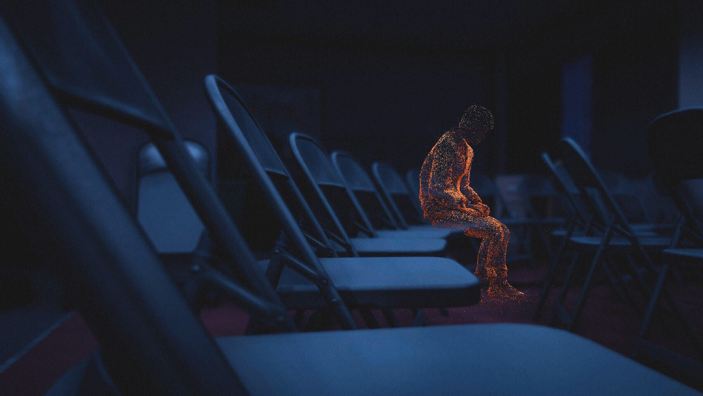
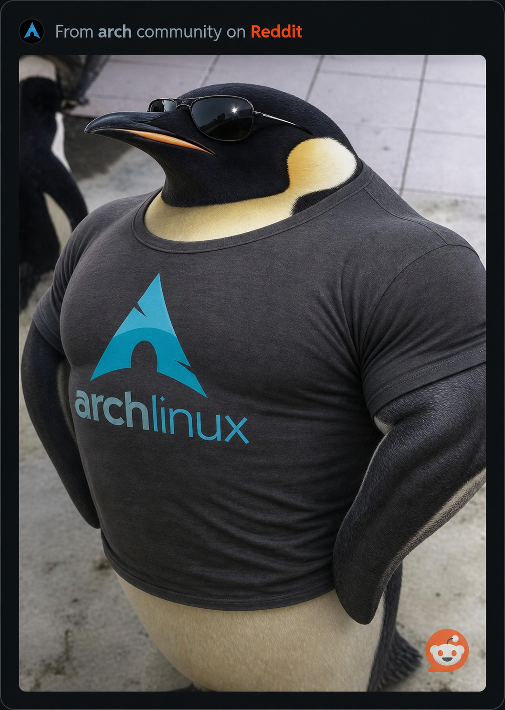
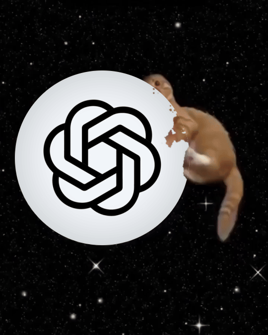
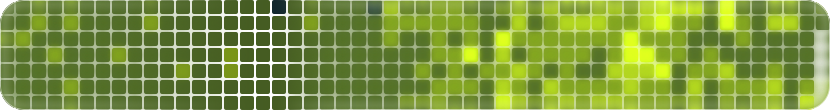
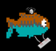
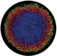

<table>
  <tr>
    <td rowspan="2">
      
    </td>
    <td align="center"></td>
    <td align="center"></td>
    <td align="center"></td>
  </tr>
  <tr>
    <td align="center"></td>
    <td align="center"></td>
    <td align="center"></td>
  </tr>
</table>
<!--
-->
<!--  -->
<!--
-->

<table>
  <tr>
    <td>
      If you were deceived by life, 
      Don’t feel dismal, don’t get mad! 
      Be at ease and don’t feel sad: 
      The days of joy will soon arrive! 
      The heart can’t wait for this to pass; 
      The present is depressing here: 
      All is fleeting rather fast; 
      That which passes will be dear.
    </td>
    <td>
      <a href="https://www.stanfish.dev/"> Personal website</a> 
      <a href="https://gastruscope.com/"> GastruScope</a> 
      <a href="https://curling.stanfish.dev/"> Curling game</a> 
      <a href="https://docs.scloop.dev/"> scloop (single-cell loop analysis)</a>
    </td>
  </tr>
</table>
<!---->
<!---->

<!---->

<!---->

<!--Contact:
zyyu@umich.edu-->
<!--
**stanfish06/stanfish06** is a ✨ _special_ ✨ repository because its `README.md` (this file) appears on your GitHub profile.

Here are some ideas to get you started:

- 🔭 I’m currently working on ...
- 🌱 I’m currently learning ...
- 👯 I’m looking to collaborate on ...
- 🤔 I’m looking for help with ...
- 💬 Ask me about ...
- 📫 How to reach me: ...
- 😄 Pronouns: ...
- ⚡ Fun fact: ...
-->
